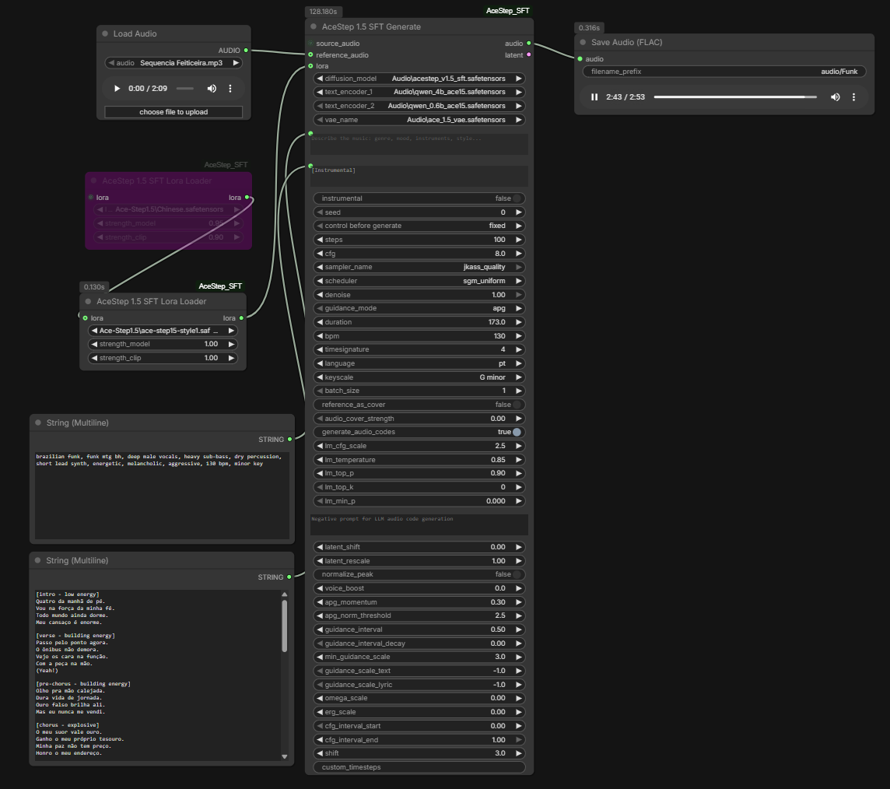

# ComfyUI-AceStep SFT

[](https://opensource.org/licenses/MIT)

A modular node suite for [ComfyUI](https://github.com/comfyanonymous/ComfyUI) that implements **AceStep 1.5 SFT** (Supervised Fine-Tuning), a state-of-the-art music generation model. It starts from the official AceStep workflow and extends it with stronger conditioning control and practical ComfyUI-oriented quality options.

> **SFT = Supervised Fine-Tuning**: A specialized version of AceStep optimized for generating superior quality audio through supervised training.

## 📋 Overview

### Optional reference audio loader

**Load Reference Audio** (`audio/AceStep SFT`) selects or uploads a voice recording and has an `enabled` switch. During execution, `true` loads the file using ComfyUI's audio decoder; `false` returns `None` without reading or validating the selected file. It starts disabled and can run without any uploaded file. The output connects to `reference_audio` on Generate, Generate Advanced, Cover/Remix or Repaint. No empty waveform is encoded. The switch controls the generation output; selecting a file still provides a local preview in the browser.

For Cover/Remix, connect the loader to the task node. Its separate `preserve_singer_identity=true` option still reuses the source song when no explicit reference is supplied; set that option to `false` if you also want to disable source-based timbre guidance. When a task already contains a reference, disabling only the direct Generate reference input does not clear the task's reference. Restart ComfyUI and refresh the browser to find the new node.

### Pure SFT quality experiments

Three generation changes are available without additional waveform processing:

- Generate `timbre_cls_token=true` restores the learned summary token omitted by this ComfyUI core's timbre encoder. It is prepended before audio and RoPE positions, as in [official XL](https://github.com/ace-step/ACE-Step-1.5/blob/main/acestep/models/xl_sft/modeling_acestep_v15_xl_base.py). ModelPatcher limits the correction to this execution; disable it to compare the previous behavior.
- Generate `guidance_mode=apg_denoised` applies APG momentum, norm clipping and projection to clean predictions `x0`, following the prediction-type analysis in the [APG paper](https://arxiv.org/html/2410.02416v2). `apg` retains velocity guidance. Both retain ACE-Step's temporal projection axes, rather than fully reproducing the paper's dimension aggregation. The norm threshold measures clean-latent units in the new mode. It also works in `jkass_quality` predictor and corrector evaluations.
- TextEncode `lm_codes_strength=0.75` uses LM codes for the first 75% of main steps and switches to separately encoded, code-free text2music conditioning for the remainder. `1` preserves full conditioning; `0` skips the LM. Corrector evaluations follow their sigma's conditioning branch too. Partial strength adds one text encoding, without generating LM codes twice. Native Cover/Repaint retain their own controls.

Restart ComfyUI and refresh the browser to load the controls. Keep caption, lyrics, both seeds, duration, sampler, scheduler, steps, CFG and shift fixed:

| Test | `timbre_cls_token` | `guidance_mode` | `lm_codes_strength` |
|------|--------------------|-----------------|---------------------|
| Previous behavior | false | apg | 1 |
| Timbre correction only | true | apg | 1 |
| Clean-prediction APG | true | apg_denoised | 1 |
| Late code release | true | apg_denoised | 0.75 |

Start with the current remaining values, including `apg_norm_threshold=2.5`. Omitting the new parameters retains existing APG/code behavior while enabling the timbre correction. The missing token was verified in code; musical improvements from the two experiments require listening comparisons. Automated checks verify math, conditioning, compatibility and patch restoration, not perceptual quality.

Generate also offers `guidance_rescale`, disabled by default (`0`). After CFG/APG/ADG, it moves the guided velocity's standard deviation toward the conditional prediction's, independently per batch sample, following [EzAudio's rescale formula](https://arxiv.org/html/2409.10819). This adaptation operates during sampling, including `jkass_quality` predictor and corrector evaluations, without extra model calls. APG still projects in `x0` when `apg_denoised` is selected; the subsequent rescale acts on velocity rather than directly on clean latents. Statistics use FP32; constant predictions use a neutral scale.

Keep `apg_denoised`, `timbre_cls_token=true` and `lm_codes_strength=1`, with identical seeds and remaining parameters. Compare only `guidance_rescale`: `0` → `0.25` → `0.50`. `1` applies the full correction. Musical improvement in ACE-Step requires listening comparisons. Restart ComfyUI and refresh the browser to load the widget, appended after existing Generate controls to preserve their order.

Generate now builds the `ace_step` schedule in FP32 by default (`schedule_precision=float32`), without changing weight or noise precision. Building it in BF16 and converting afterward has already lost precision: CPU checks at `shift=3` found 3/13/35 repeated-sigma intervals for 50/100/200 steps, where the integrator did not advance. `schedule_precision=model` reproduces the previous precision for comparison. Other schedulers and native Cover's fallback schedule for a non-`ace_step` scheduler retain their precision. The control is appended after existing widgets; restart ComfyUI once running generations finish.

Experimental `guidance_mode=apg_denoised_joint` projects clean predictions jointly across channels and time, separately per batch sample. This follows the geometry of the [APG algorithm](https://arxiv.org/html/2410.02416v2) and the [Stable Audio 3 audio implementation](https://github.com/Stability-AI/stable-audio-3/blob/main/optimized/mlx/scripts/sa3_mlx.py). Existing `apg_denoised` retains per-channel projection. Joint projection removes one parallel direction instead of one per channel; retaining more variation may help, but ACE-Step perceptual improvement is unverified. To avoid eight-times stricter global clipping, its radius is `apg_norm_threshold * sqrt(channels)`: 2.5 becomes 20 for 64 channels. This is an adaptation to the previous aggregate budget, not a paper-recommended setting. Momentum and rescale remain available, without additional model calls.

First compare `schedule_precision=model` and `float32` while retaining `apg_denoised`. Then fix `float32` and compare `apg_denoised` against `apg_denoised_joint`. Keep full LM codes, timbre correction, seeds and all other settings identical; start with `guidance_rescale=0` to isolate projection. Judge instruments/rhythm and sung words separately.

### New clarity experiments using pure SFT

Generate adds `apg_norm_rms` as the last widget. `0` preserves the fixed L2 cap from `apg_norm_threshold`. A positive value replaces it with an APG update RMS cap, before projection and CFG, independent of duration. This is not audio RMS or volume. With 180 seconds, 64 channels and 4,500 frames, joint APG threshold 2.5 caps update RMS at 0.0373; at 30 seconds the same cap permits 0.0913. Duration dependence is mathematical; its audible effect remains unverified. The [APG paper](https://arxiv.org/html/2410.02416v2) warns against excessive clipping, but RMS normalization for audio is our adaptation.

First retain the configuration you prefer, including `apg_denoised_joint`, and change only `apg_norm_rms`: `0`, `0.05`, `0.075`. At 180 seconds, the positive values yield radii 26.83 and 40.25 instead of 20. Other APG modes apply the cap in their own prediction space; ADG/CFG ignore it. Restart ComfyUI after ongoing generations finish to load the appended widget.


### Audio clarity: optional VAE comparison

[ScragVAE](https://huggingface.co/scragnog/Ace-Step-1.5-ScragVAE) retrains the decoder to improve upper-frequency and transient reconstruction. Published gains are author-reported and require listening comparisons on your audio. Use the [ComfyUI conversion](https://huggingface.co/megagrump/Ace-Step-1.5-ScragVAE-ComfyUI), `ace_1.5_scrag_vae.safetensors`, in `ComfyUI/models/vae`, then select it in Model Loader `vae_name`. Renaming the original Diffusers checkpoint does not make it loadable here.

First change only the VAE, keeping the seed and all other settings. To isolate decoding completely, connect Generate's `latent` output to two `VAE Decode Audio` nodes, each using a separate `Load VAE`, and compare their previews. Keep `latent_shift=0`, `latent_rescale=1`, and fades/voice boost disabled for this comparison. This changes reconstruction within generation without waveform equalization. Sampling, including `jkass_quality`, remains identical; guidance settings do not need to change.

The two local checkpoints have different encoder weights. The encoder is not used for text2music without reference audio; swapping the VAE for Cover/Remix with an audio reference can also change encoding. Comparing the same `latent` isolates the decoder.

### Current sampling defaults and Gradio alignment

Reference: [ACE-Step 1.5 at ca1e85f](https://github.com/ace-step/ACE-Step-1.5/tree/ca1e85fe9430179831e6bc6be790c332190a3866), checked against both Gradio controls and SFT `generate_audio`.

Use `sampler_name=jkass_quality`, `scheduler=ace_step`, `noise_source=official`, `steps=50`, `cfg=7`, `shift=3`, `infer_method=ode`, `guidance_mode=apg`. New nodes/widgets use these defaults; saved workflows retain their existing selections. Keep TextEncode/Generate duration equal, or use Generate `duration=0` to inherit encoded duration when no source audio/latent is connected.

- `ace_step` supplies the shifted linear schedule in FP32 by default; `schedule_precision=model` retains the previous dtype. CFG interval bounds are diffusion timesteps (1 down to 0); other schedulers retain elapsed-step fractions. `guidance_interval` can further restrict the centered interval.
- `jkass_quality` is bundled from JK-AceStep-Nodes. It preserves the original second-order Heun updates and callbacks; the JK pack does not need to be installed. With a schedule ending at zero, N steps use 2N−1 model evaluations (99 for 50 steps). The last step returns the clean prediction.
- Gradio noise uses model device/dtype and BTC layout. Comfy noise preserves CPU sampling. Batch seeds are `seed + index`, rather than Gradio's randomly chosen additional seeds.
- Output retains the existing anti-clipping safeguard, without target-level normalization. The sampler displays console progress through ComfyUI.
- The default LM prompt and sampling remain CFG 2, temperature 0.85, top-p 0.9, top-k 0. APG/ADG and null conditioning follow SFT math.
- APG re-evaluations at the same consecutive timestep (as in Heun/`jkass_quality`) reuse the preceding momentum history while recomputing the current prediction. This avoids advancing momentum twice at that timestep; Euler keeps the original recurrence.
- In this installation, the core does not propagate attention windows to the lyric and timbre encoders. Generate's `reference_xl_attention` option applies the model's configured windows to timbre attention, following XL's local/global alternation. It uses ModelPatcher during reference generation without editing the core or lyric encoder, and is enabled by default. Set it to `false` to compare previous behavior.

Local stability fixes: native LM sampling computes CFG and probabilities in FP32, following the official PyTorch backend, and `lm_top_p=0` disables the filter. The code budget uses `int(duration * 5)` without first rounding duration to whole seconds. Generate warns when its duration differs by more than one second from the LM duration. Over-range input audio is scaled proportionally, preserving waveform shape and stereo balance. Native forward also keeps a separate timbre reference for each batch sample. The two ComfyUI core fixes live in `comfy/text_encoders/ace15.py` and `comfy/ldm/ace/ace_step15.py`; updating ComfyUI may overwrite them.

Gradio SFT uses constant CFG (`guidance_schedule=normal`). Select `decay` and `min_guidance_scale=1` for CFG 7 → 1, or `ramp_up` for 1 → 7. Checkpoint filenames never override the requested CFG, since merged weights cannot be identified reliably by name.

Equivalence is limited by ComfyUI's LM, attention, integration precision and VAE. `jkass_quality` always uses ODE integration. `infer_method=sde` only remaps the supported ComfyUI Euler/Heun choices to their SDE alternatives; it does not turn JKASS into SDE. The bundled sampler is not Gradio's Euler solver. Automatic metadata/caption CoT, DCW, retake and flow-edit were not ported; Gradio disables DCW by default for SFT. Matching parameters does not guarantee identical audio.

Run `python -m unittest discover -s tests -v`. Set `ACESTEP_REFERENCE_DIR` to the pinned upstream checkout to enable direct noise/APG/ADG comparisons.

This package provides **twelve nodes** under `audio/AceStep SFT`:

| Node | Purpose |
|------|---------|
| **AceStep 1.5 SFT Model Loader** | Loads the diffusion model, CLIP text encoders, and VAE |
| **AceStep 1.5 SFT Lora Loader** | Applies a LoRA to MODEL + CLIP (chainable) |
| **AceStep 1.5 SFT TextEncode** | Encodes caption, lyrics, and metadata into conditioning |
| **AceStep 1.5 SFT Generate** | Diffusion sampler + optional VAE decode |
| **AceStep 1.5 SFT Generate Advanced** | Explicit noise and step-range controls for staged sampling |
| **AceStep 1.5 SFT Cover / Remix** | Native structural cover/remix conditioning from source audio |
| **AceStep 1.5 SFT Inpaint / Repaint** | Native time-range regeneration with source preservation |
| **AceStep 1.5 SFT Preview Audio** | Audio playback with waveform spectrum visualizer |
| **AceStep 1.5 SFT Save Audio** | Save audio (FLAC/MP3/Opus) with waveform visualizer |
| **AceStep 1.5 SFT Audio Duration** | Returns the audio duration as an integer number of seconds |
| **AceStep 1.5 SFT Get Music Infos** | Native transcription with ACE-Step-formatted lyrics, tags, BPM, and key/scale |
| **AceStep 1.5 SFT Turbo Tag Adapter** | Rewrites Turbo-oriented tags into SFT-friendly tags (BETA) |


### Sampler migration

`ace_step_euler` has been removed. In saved workflows that used it, select `jkass_quality` in Generate. The `ace_step` scheduler remains available. Restart ComfyUI and refresh the page to reload the choices. The local copy does not modify the global sampler registry or the JK pack; even with JK installed, Generate uses the bundled implementation and shows only one `jkass_quality` entry.

CFG 7 → 1 remains available with `guidance_schedule=decay` and `min_guidance_scale=1`; `ramp_up` reverses it. Scheduling follows actual timesteps without counting Heun corrector evaluations as additional steps. The `enable_normalization`, `normalization_db`, `velocity_norm_threshold` and `velocity_ema_factor` controls have been removed; output peak protection remains.

### Modular Architecture

The workflow is split into dedicated nodes for maximum flexibility:

```
Model Loader → (model, clip, vae)
       │            │        │
       │   Lora Loader (optional, chainable)
       │     │    │          │
       │     │  TextEncode   │
       │     │   │    │      │
       ▼     ▼   ▼    ▼      ▼
      Generate (model, positive, negative, vae)
         │         │
    Preview Audio  Save Audio
```

### Example Configuration



## 🎯 Key Features

### ✨ Advanced Guidance

The node supports four classifier-free guidance modes:

- **APG (Adaptive Projected Guidance)** ⭐ *Recommended*
  - Dynamic adaptation via momentum buffering
  - Gradient clipping with adaptive thresholds
  - Orthogonal projection to eliminate unwanted noise
  - **AceStep SFT Default** - best quality and stability balance

- **Clean-prediction APG (`apg_denoised`)**
  - Experimental APG on `x0`, with the same momentum and norm controls
  - See the pure SFT quality experiments above

- **ADG (Angle-based Dynamic Guidance)**
  - Angle-based guidance between conditions
  - Operates in velocity space (flow matching)
  - Ideal for aggressive style distortion

- **Standard CFG**
  - Traditional Classifier-Free Guidance
  - Simple and predictable implementation
  - Useful as a comparison baseline

### 🎵 Intelligent Metadata Processing

- **Auto-Duration**: Automatically estimates music duration by analyzing lyric structure
- **LLM Encoding**: Use Qwen LLM (0.6B or 1.7B/4B) to generate semantic audio codes
- **Auto Values**: BPM, Time Signature, and Key/Scale automatic (model decides)
- **Multilingual Support**: Over 23 languages supported

### 🎧 AI Music Analyzer

- **Audio Tag Extraction**: Derives lyric, vocal, and song-structure tags from the selected transcription model
- **Formatted Lyrics Output**: Returns a `lyrics` STRING with ACE-Step section markers for direct connection to TextEncode; Whisper output uses bounded `[Verse N]` blocks, while the native model preserves its own detected sections
- **BPM Detection**: Automatic tempo detection via librosa
- **Key/Scale Detection**: Detects musical key and scale (e.g. "G minor")
- **JSON Output**: Structured `music_infos` output with all analysis results

### 🔊 Audio Preview & Save with Waveform Visualizer

Both Preview Audio and Save Audio nodes feature:
- **Interactive waveform spectrum** display directly on the node (dark background with amplitude bars)
- **Play/Pause button** with click-to-seek on the waveform
- **Time display** showing current position and total duration

Save Audio additionally supports:
- **Multiple formats**: FLAC (lossless), MP3, and Opus
- **Quality options**: V0, 64k, 96k, 128k, 192k, 320k
- **Auto-incrementing filenames** with configurable prefix

### 🔄 Audio Refinement (img2img)

- **Latent-based Refinement**: Use `denoise < 1.0` with `latent_or_audio` connected to refine existing audio
- **Accepts AUDIO or LATENT**: Connect any audio or latent output for img2img-style editing
- **Batch Generation**: Generate multiple variations in parallel

### New music with a voice reference

Connect a vocal recording from Load Audio directly to Generate's optional `reference_audio`, with no Cover/Remix task or source song. Set the new song's caption, lyrics, language and duration in TextEncode as usual. Connect VAE to Generate when the reference is AUDIO. The reference guides global acoustic features, including vocal timbre; it does not supply the new lyrics or guarantee an identical singer.

Generate Advanced accepts the same input. For split generation, connect the reference to every stage and continue the first stage's LATENT with `add_noise=disable`. The reference is encoded for each stage; LM audio codes and the requested duration retain their normal behavior. Without LM codes, the composition context uses encoded silence rather than treating the spoken recording as a source song.

For a muffled result, first save Generate's AUDIO directly and compare it with any Music Fix, stereo or loudness processing of the same generation. Use a clearly recorded reference with adequate level and little silence; including singing is a useful comparison to a short spoken clip. No automatic EQ, gain boost or precision change is applied to compensate for a reference.

`reference_xl_attention=true` is the default to bring timbre extraction closer to the [official XL encoder](https://github.com/ace-step/ACE-Step-1.5/blob/main/acestep/models/xl_sft/modeling_acestep_v15_xl_base.py). The option gives the timbre encoder the decoder's configured attention windows; it does not change LM codes or use speech as a composition source. For comparison, use `false` in test A and `true` in B while holding the reference, seed and all other fields constant. It works in Generate and Advanced independently of `timbre_cls_token`, and restores patches after completion or errors. With no reference, attention remains unchanged. Tests verify windows and restoration; clarity and vocal similarity require listening comparisons.

Two additional controls experiment with stronger direct-reference conditioning in Generate and Generate Advanced:

- `reference_guidance_scale` (default `1`): at `1`, keeps the original single prediction. Other values compare predictions with the reference and encoded silence, with identical text, lyrics and composition context, then extrapolate the difference. This adds a model evaluation for each conditional evaluation. It runs **before** CFG/APG: with CFG 7, start a comparison around `1.2–1.25`, rather than immediately using `2–4`.
- `reference_timbre_repeats` (default `1`): repeats the encoded timbre token before cross-attention, increasing its relative attention weight without increasing its amplitude. Compare `1` against `2` or `3` separately from guidance. It does not repeat the audio or song. This emphasizes global reference acoustics, not an independently trained speaker-identity embedding.

These are experimental, inference-only methods, not official ACE-Step cloning features. They apply to direct `reference_audio` without a `task`, and their patches are restored after generation, including on errors. Set both to `1` to retain the previous behavior. Strong settings can change composition, diction or sound quality. Keep the same seed, reference, caption, lyrics and LM settings for comparisons; speaker-embedding scores across speech and singing are not identity percentages or substitutes for listening. No execution log files are added; generation uses the existing native ComfyUI progress.

### 🎛️ Native Cover, Remix, and Inpaint

These operations use the ACE-Step 1.5 conditioning paths on which the model was trained. They are separate from `latent_or_audio`; the existing img2img-style audio-to-audio flow remains unchanged.

Connect a task node's output to **both** `TextEncode.task` and `Generate.task`:

```text
Load Audio/Latent → Cover / Remix ─┬→ TextEncode.task
                                   └→ Generate.task

Load Audio/Latent → Inpaint / Repaint ─┬→ TextEncode.task
                                       └→ Generate.task
```

- **Cover / Remix**: Receives the complete source song and regenerates a complete result—both the vocal performance and the instrumentation—in the requested style. In upstream ACE-Step, Remix is the UI name for the same `cover` task.
- **Semantic FSQ**: Recommended mode; extracts 5 Hz semantic codes and reconstructs 25 Hz structural hints, allowing a stronger style/timbre change while following the source composition.
- **Raw no-FSQ**: Advanced mode that conditions on the acoustic latent directly and therefore retains more of the source sound.
- **Remix strength**: `remix_strength = 0.4` is the default and recommended starting point here. The official guide suggests approximately `0.3–0.5` for a dramatic genre change; this value is the fraction of sampling steps that use Cover conditioning.
- **Singer identity (best effort)**: With `preserve_singer_identity` enabled, the source song is also used as `reference_audio` by default. This guides vocal timbre but is not exact voice cloning because Cover regenerates the full waveform. An explicit `reference_audio` replaces the automatic source reference.
- **Lyrics are explicit**: To retain the original words, paste the original lyrics into TextEncode. Native Cover does not infer or preserve lyrics from an empty lyrics field, and `generate_audio_codes` is disabled for the task.
- **Model presets**: Use CFG `1`, `8` steps, ODE, and shift `3` for Turbo. Use CFG `7` for Base/SFT.
- **Inpaint / Repaint**: Regenerates only `start_seconds:end_seconds` using the native repaint instruction, source latent with a silenced edit region, and a 64-channel ACE chunk mask.
- **Source preservation**: Reinjects the appropriately noised source during sampling, blends latent boundaries, then restores the original waveform outside the edit range with a short crossfade.

For native tasks, source duration and batch size come from the task. Audio-code generation is disabled automatically. The legacy img2img-style `latent_or_audio` path is unchanged and must remain disconnected in this flow.

### 🧠 Extended Conditioning Control

- **Split Text/Lyric Guidance**: Independent `guidance_scale_text` and `guidance_scale_lyric`
- **Omega Scale**: Mean-preserving output reweighting to approximate AceStep scheduler behavior
- **ERG Approximation**: Node-local prompt energy reweighting via `erg_scale`
- **Guidance Interval Decay**: Smoothly decay guidance inside the active interval

### 🎚️ AceStep LoRA Workflow

- **Direct LoRA Application**: The Lora Loader takes MODEL + CLIP, applies the LoRA via `comfy.sd.load_lora_for_models()`, and outputs the modified MODEL + CLIP
- **Chainable**: Stack multiple Lora Loaders in sequence
- **Separate strengths**: Independent `strength_model` and `strength_clip`
- **DoRA support**: Full DoRA (Weight-Decomposed Low-Rank Adaptation) support with automatic `dora_scale` dimension fix
- **Local `Loras/` folder**: Drop LoRA files directly into the node's `Loras/` folder — they are automatically registered at startup
- **Auto PEFT/DoRA conversion**: PEFT-format LoRAs (`adapter_config.json` + `adapter_model.safetensors`) placed in `Loras/` are automatically converted to ComfyUI format on first startup

### 🛠️ Latent Post-processing

- **Latent Shift**: Optional additive latent offset (default 0)
- **Latent Rescale**: Multiplicative scaling for dynamic control

## 📦 Installation

### Prerequisites

- ComfyUI installed and functional
- CUDA/GPU or equivalent (modern processors)
- Recommended for better output quality (based on practical testing): use the merged SFT+Turbo model.
- Required model files:
  - Diffusion model (DiT): `acestep_v1.5_sft.safetensors`
  - Text Encoders: `qwen_0.6b_ace15.safetensors`, `qwen_1.7b_ace15.safetensors` (or 4B)
  - VAE: `ace_1.5_vae.safetensors`

### Download Model Files

Download the required models from HuggingFace:

1. **Diffusion Model (Recommended: merged SFT+Turbo)**:
  - [AceStep 1.5 Merged SFT+Turbo Model](https://huggingface.co/Aryanne/acestep-v15-test-merges/blob/main/acestep_v1.5_merge_sft_turbo_ta_0.5.safetensors)

2. **Alternative Diffusion Model (official SFT)**:
   - [AceStep 1.5 SFT Model](https://huggingface.co/ACE-Step/acestep-v15-sft/blob/main/model.safetensors)

3. **Text Encoders** (choose any versions):
   - [Text Encoders Collection](https://huggingface.co/Comfy-Org/ace_step_1.5_ComfyUI_files/tree/main/split_files/text_encoders)
     - `qwen_0.6b_ace15.safetensors` (caption processing)
     - `qwen_1.7b_ace15.safetensors` or `qwen_4b_ace15.safetensors` (audio code generation)

4. **VAE** (Audio codec):
   - [AceStep 1.5 VAE](https://huggingface.co/Comfy-Org/ace_step_1.5_ComfyUI_files/blob/main/split_files/vae/ace_1.5_vae.safetensors)

### Installation Steps

1. Clone the repository to your custom nodes folder:
```bash
cd ComfyUI/custom_nodes
git clone https://github.com/jeankassio/ComfyUI-AceStep_SFT.git
```

2. Place model files in the appropriate directories:
```
ComfyUI/models/diffusion_models/     # AceStep 1.5 SFT model
ComfyUI/models/text_encoders/        # Qwen encoders
ComfyUI/models/vae/                  # VAE
ComfyUI/models/loras/                # Optional AceStep 1.5 LoRAs
```

3. **(Optional) Place LoRAs in the local folder:**
```
ComfyUI/custom_nodes/ComfyUI-AceStep_SFT/Loras/   # Local LoRA folder
```
   You can place LoRAs here in **any** of these formats:
   - **ComfyUI format**: Single `.safetensors` file (ready to use)
   - **PEFT/DoRA format**: A folder containing `adapter_config.json` + `adapter_model.safetensors` (auto-converted on startup)
   - **Nested zip artifact**: If your zip extracted a folder-inside-folder, the node detects this and fixes it automatically

4. Install `requirements.txt` using the same Python environment that runs ComfyUI. For Windows portable, from its root:
```powershell
.\python_embeded\python.exe -m pip install -r .\ComfyUI\custom_nodes\ComfyUI-AceStep_SFT\requirements.txt
```

5. Restart ComfyUI - the nodes will appear under `audio/AceStep SFT`. Use a ComfyUI version with native ACE-Step 1.5 support. The local core fixes described above are separate from this custom-node repository.

## 🧩 Available Nodes

### AceStep 1.5 SFT Model Loader

Loads the AceStep 1.5 diffusion model, dual CLIP text encoders, and audio VAE.

Inputs:
- `diffusion_model`: AceStep 1.5 diffusion model (.safetensors)
- `text_encoder_1`: Qwen3-0.6B encoder (caption processing)
- `text_encoder_2`: Qwen3 LLM (1.7B or 4B, audio code generation)
- `vae_name`: AceStep 1.5 audio VAE

Outputs:
- `model`: MODEL — connect to Lora Loader or Generate
- `clip`: CLIP — connect to Lora Loader or TextEncode
- `vae`: VAE — connect to Generate

### AceStep 1.5 SFT Lora Loader

Applies a LoRA directly to the MODEL and CLIP. Multiple Lora Loaders can be chained.

Inputs:
- `model`: MODEL from Model Loader or previous Lora Loader
- `clip`: CLIP from Model Loader or previous Lora Loader
- `lora_name`: LoRA file from `ComfyUI/models/loras` or the local `Loras/` folder
- `strength_model`: strength applied to the diffusion model
- `strength_clip`: strength applied to the text encoder stack

Outputs:
- `model`: MODEL — connect to next Lora Loader or Generate
- `clip`: CLIP — connect to next Lora Loader or TextEncode

#### Supported LoRA Formats

| Format | What to place in `Loras/` | Action |
|--------|--------------------------|--------|
| ComfyUI `.safetensors` | Single file | Used directly |
| PEFT/DoRA directory | Folder with `adapter_config.json` + `adapter_model.safetensors` | Auto-converted to `*_comfyui.safetensors` on startup |
| Nested zip artifact | Folder containing a `.safetensors` inside | Auto-extracted to root on startup |

### AceStep 1.5 SFT Cover / Remix

Creates a native full-song cover/remix task. Connect the complete song to `source`, then branch the `task` output to the `task` inputs on both TextEncode and Generate. Generate returns a newly synthesized complete mix: the singer performs in the target style and the instruments are regenerated with it.

Inputs:
- `source`: AUDIO or LATENT that supplies melody, rhythm, and structure
- `source_conditioning`: `semantic_fsq` (recommended) or `raw_no_fsq`
- `remix_strength`: fraction of sampling that uses Cover conditioning; default `0.4`. The official guide recommends approximately `0.3–0.5` for a dramatic genre change
- `cover_noise_strength`: default `0.2`; `0` starts from pure noise, while higher values initialize closer to the source
- `preserve_singer_identity`: enabled by default; also uses the source song as `reference_audio` to guide the regenerated singer's timbre. Disable it for a freely generated voice
- Optional `reference_audio`: explicit AUDIO or LATENT timbre/voice reference; when connected, it replaces the automatic source reference

Singer identity is best effort, not exact voice cloning: Cover/Remix regenerates the complete waveform, including the vocal performance. Keep `source_conditioning = semantic_fsq` for the normal remix path. Paste the original lyrics explicitly into TextEncode if the cover must sing the same words; an empty lyrics input does not transcribe the source. Native tasks disable `generate_audio_codes` because the real source audio supplies the native conditioning.

For **Turbo**, use CFG `1`, `8` steps, ODE, and shift `3`. Native Cover uses ACE-Step's shifted-linear timesteps and peak-normalizes decoded audio instead of hard clipping it. For **Base/SFT**, use CFG `7`. The legacy img2img-style `latent_or_audio` input remains unchanged and disconnected from this workflow.


### AceStep 1.5 SFT Inpaint / Repaint

Creates a native time-range repaint task. Its `task` output must be branched to the `task` inputs on both TextEncode and Generate.

Inputs:
- `source`: AUDIO or LATENT to edit
- `start_seconds`, `end_seconds`: regenerated interval (`-1` means source end)
- `repaint_mode`: `conservative`, `balanced`, or `aggressive`
- `repaint_strength`: preservation/freedom balance used by `balanced` mode
- Optional `reference_audio`: independent timbre/style reference for the regenerated region

### AceStep 1.5 SFT TextEncode

Encodes caption, lyrics, and metadata into positive and negative conditioning for the Generate node.

Inputs:
- `clip`: CLIP from Model Loader or Lora Loader
- `caption`: Text description of the music (genre, mood, instruments)
- `lyrics`: Song lyrics or `[Instrumental]`
- `instrumental`: Force instrumental mode
- `seed`, `duration`, `bpm`, `timesignature`, `language`, `keyscale`
- Optional: `task`, `generate_audio_codes`, `lm_cfg_scale`, `lm_temperature`, `lm_top_p`, `lm_top_k`, `lm_min_p`, `lm_negative_prompt`
- Optional style overrides: `style_tags`, `style_bpm`, `style_keyscale` (from Music Analyzer)

Outputs:
- `positive`: CONDITIONING — connect to Generate
- `negative`: CONDITIONING — connect to Generate

### AceStep 1.5 SFT Generate

Diffusion sampler + optional VAE decoder. Requires MODEL and conditioning inputs.

Inputs:
- `model`: MODEL from Model Loader or Lora Loader
- `positive`: CONDITIONING from TextEncode
- `negative`: CONDITIONING from TextEncode
- Sampling: `seed`, `steps`, `cfg`, `sampler_name`, `scheduler`, `denoise`, `duration`, `infer_method`, `guidance_mode`
- Optional: `vae` (for audio output), `latent_or_audio` (for existing img2img), `task` (for native editing), `batch_size`
- Optional post-processing: `latent_shift`, `latent_rescale`, `fade_in_duration`, `fade_out_duration`, `voice_boost`, `use_tiled_vae`
- Optional guidance: `apg_eta`, `apg_momentum`, `apg_norm_threshold`, `guidance_interval`, `guidance_schedule`, `min_guidance_scale`, `guidance_scale_text`, `guidance_scale_lyric`, `omega_scale`, `erg_scale`, `cfg_interval_start`, `cfg_interval_end`, `shift`

Outputs:
- `model`: MODEL (passthrough for chaining)
- `vae`: VAE (passthrough for chaining)
- `positive`: CONDITIONING (passthrough)
- `negative`: CONDITIONING (passthrough)
- `latent`: LATENT (raw diffusion output)
- `audio`: AUDIO (decoded audio, only when VAE is connected)

### AceStep 1.5 SFT Generate Advanced

Adds KSampler Advanced-style controls while retaining Generate's sampler choices (including `jkass_quality`), guidance controls and outputs. The regular Generate is unchanged. Advanced uses `noise_seed` instead of `seed`, omits `denoise`, and adds:

| Control | Default | Behavior |
|---------|---------|----------|
| `add_noise` | `enable` | `disable` continues an existing noisy latent without adding fresh noise |
| `start_at_step` | `0` | First step to execute on the full `steps` schedule |
| `end_at_step` | `10000` | Stop boundary, capped at the full schedule's final step |
| `return_with_leftover_noise` | `disable` | `enable` preserves the noise level at an intermediate boundary; `disable` finishes at zero noise |

For two stages with `steps=50`, use the same sampler, scheduler, shift and `noise_seed` in both nodes:

| Stage | `add_noise` | `start_at_step` | `end_at_step` | `return_with_leftover_noise` |
|-------|-------------|-----------------|---------------|------------------------------|
| First | `enable` | `0` | `25` | `enable` |
| Final | `disable` | `25` | `50` | `disable` |

Connect the first node's `latent` output to the second node's `latent_or_audio`. Unfinished ranges and ranges that execute no steps skip AUDIO decoding, even with a VAE connected.

Advanced also accepts native Cover/Remix and Repaint through the optional `task` input. Connect the same task to TextEncode and every Advanced stage, and connect VAE to each native-task stage to encode its source and reference. The final stage can use `task` together with the previous stage's LATENT when `add_noise=disable`; it continues that latent while restoring source/reference conditioning for the selected model. A task together with an AUDIO input or fresh startup noise is ambiguous and is not accepted.

Cover's `start_at_step` and `end_at_step` use the original full schedule, even when `cover_noise_strength` skips initial steps. With 50 steps, `cover_noise_strength=0.2` and `shift=1`, the automatic start is step 10: a first range of 0–25 executes 10–25, followed by 25–50. Repaint's source blending and waveform splice run only when the final stage finishes at zero noise.

`guidance_schedule` and the LM-code handoff use the full schedule instead of restarting in each stage. Splitting stages adds control, not a guaranteed quality gain. APG momentum, multistep solver history and SDE noise state may reset between nodes, so not every configuration matches a single uninterrupted run. Deterministic `standard_cfg` with the Heun-based `jkass_quality` supports continuation. No ComfyUI core changes or additional dependencies are required.

### AceStep 1.5 SFT Preview Audio

Previews audio with an interactive waveform spectrum visualizer directly on the node.

Inputs:
- `audio`: AUDIO to preview

Features:
- Interactive waveform display with play/pause button
- Click-to-seek on the waveform
- Current time / total duration display

### AceStep 1.5 SFT Save Audio

Saves audio to disk with an interactive waveform spectrum visualizer.

Inputs:
- `audio`: AUDIO to save
- `filename_prefix`: Filename prefix (supports subfolder paths, e.g. `audio/AceStep`)
- `format`: FLAC, MP3, or Opus
- `quality` (optional): V0, 64k, 96k, 128k, 192k, 320k (for MP3/Opus)
- **Save Metadata** (`save_metadata`, optional, default: enabled): Embed the ComfyUI prompt and workflow in the audio. Disable to save without these metadata in FLAC, MP3, or Opus. The global `--disable-metadata` flag always disables embedding. Existing workflows keep their previous behavior when this input is omitted.

Features:
- Auto-incrementing filenames (e.g. `AceStep_00001_.flac`, `AceStep_00002_.flac`)
- Waveform visualizer with play/pause and seek
- Optional metadata embedding (prompt, workflow)

### AceStep 1.5 SFT Audio Duration

Receives a ComfyUI `AUDIO` value and returns `duration_seconds` as an `INT`, rounded to the nearest whole second. A disabled Load Reference Audio output (`None`) returns `0`; malformed audio still raises an error. It reads the in-memory waveform directly and does not load any model.

### AceStep 1.5 SFT Get Music Infos

AI-powered audio analysis node that extracts descriptive tags, ACE-Step-formatted lyrics, BPM, and key/scale from audio input. Whisper large-v3 is the accurate lyrics default; long songs are transcribed in bounded segments and merged before tags and lyrics are returned.

Inputs:
- `audio`: Audio input to analyze
- `get_tags` / `get_lyrics` / `get_bpm` / `get_keyscale`: Enable/disable each analysis
- `max_new_tokens`: Maximum token ceiling for each transcription segment
- `audio_duration`: Max seconds of audio to analyze
- `transcription_chunk_seconds`: Segment length for long-song transcription; default `30` prevents a decoder loop in one passage from consuming the complete output
- `lyrics_model`: `Whisper-large-v3-transcription` (accurate default), Whisper Turbo (faster), or the native ACE-Step Transcriber
- `lyrics_language`: Optional language hint; `auto` by default, or use `pt` for Brazilian Portuguese when vocals are heavily processed
- `temperature`, `top_p`, `top_k`, `repetition_penalty`, `seed`: Generation parameters
- `unload_model`: Free VRAM after analysis
- `use_flash_attn`: Enable Flash Attention 2 (if compatible)
- `free_vram_before`: Unload ComfyUI generation models before loading the selected transcription model

Outputs:
- `tags`: Comma-separated descriptive tags (STRING)
- `bpm`: Detected BPM (INT)
- `keyscale`: Key and scale e.g. "G minor" (STRING)
- `music_infos`: JSON with all results (STRING)
- `lyrics`: Lyrics ready for TextEncode, with ACE-Step section markers preserved (STRING)

### AceStep 1.5 SFT Turbo Tag Adapter

Rewrites Turbo-oriented music tags into shorter SFT-friendly prompt tags.

Inputs:
- `turbo_tags`: Turbo-style tags or caption
- `adaptation_strength`: conservative / balanced / aggressive
- `keep_unknown_tags`: Keep tags that were not explicitly mapped
- `add_sft_bias_tags`: Add extra SFT-oriented anchor tags

Outputs:
- `sft_tags`: Adapted comma-separated tags (STRING)
- `notes`: Conversion notes (STRING)
- `suggested_cfg`: Suggested CFG value (FLOAT)
- `suggested_steps`: Suggested steps value (INT)

## 🎛️ Node Parameters

### Generate - Required Parameters

| Parameter | Range | Description |
|-----------|-------|-------------|
| **model** | MODEL | AceStep 1.5 diffusion model from Model Loader or Lora Loader |
| **positive** | CONDITIONING | Positive conditioning from TextEncode |
| **negative** | CONDITIONING | Negative conditioning from TextEncode |
| **seed** | 0 - 2^64 | Seed for reproducibility |
| **steps** | 1 - 200 | Diffusion inference steps (default: 50) |
| **cfg** | 1.0 - 20.0 | Classifier-free guidance scale (default: 7.0) |
| **sampler_name** | jkass_quality / ComfyUI | Heun JKASS local (default) |
| **scheduler** | ace_step | ACE-Step shifted-linear / schedulers ComfyUI |
| **denoise** | 0.0 - 1.0 | Denoising strength (1.0 = fresh, < 1.0 = editing) |
| **duration** | 0.0 - 600.0 | Duration in seconds (0 = auto) |
| **infer_method** | ode/sde | SDE remaps supported ComfyUI samplers; JKASS remains ODE |
| **guidance_mode** | apg/adg/standard_cfg/apg_denoised | Guidance type (default: apg) |

### Generate - Optional Parameters

#### Batch Generation
- **batch_size** (1-16): Number of audios to generate in parallel

#### Execution controls
- **noise_source** (`official`/`comfy`, default: `official`): Model-device/dtype noise or ComfyUI CPU noise
- **unload_models_after_generate** (default: False): Unloads models after generation

#### Audio Input
- **vae**: VAE from Model Loader (required for audio output)
- **latent_or_audio**: Base input for refinement (img2img). Accepts AUDIO or LATENT. `denoise=0` preserves the source latent; `denoise<1` starts at the requested noise fraction
- **task**: Native Cover/Remix or Inpaint/Repaint task, connected to TextEncode as well. Regular Generate keeps it mutually exclusive with `latent_or_audio`; Advanced can combine it with a continuation LATENT when `add_noise=disable`.
- **reference_audio**: Optional AUDIO/LATENT timbre reference for a new song, independent of `task` and `latent_or_audio`. When a task is also connected, this input overrides its reference without changing the task's source.
- **reference_xl_attention**: Enabled by default to apply the model's configured attention windows to the timbre encoder. Only active with a voice reference; `false` restores previous attention behavior.

#### Latent Post-processing
- **latent_shift** (-0.2-0.2, default: 0.0): Additive latent shift; keep 0 unless intentionally altering the decode
- **latent_rescale** (0.5-1.5, default: 1.0): Multiplicative scaling
- **fade_in_duration / fade_out_duration** (0.0-10.0, default: 0.0): Optional linear fades
- **use_tiled_vae** (default: True): Decodes 1D audio in context-padded chunks and discards boundary predictions; reduces peak VRAM
- **voice_boost** (-12.0-12.0, default: 0.0): Whole-mix gain in dB before peak protection; does not isolate vocals

#### APG Configuration
- **apg_eta** (-10.0-10.0, default: 0.0): Parallel component retention
- **apg_momentum** (-1.0-1.0, default: -0.75): Momentum buffer coefficient
- **apg_norm_threshold** (0.0-15.0, default: 2.5): Norm threshold for gradient clipping

#### Extended Guidance Controls
- **guidance_interval** (-1.0-1.0, default: 1.0): Centered guidance interval width; `1.0` covers the complete official schedule
- **guidance_schedule** (`normal`, `decay`, `ramp_up`; default: `normal`): `normal` keeps CFG constant, `decay` ramps CFG → minimum, and `ramp_up` ramps minimum → CFG. Ramps are linear inside the active guidance interval and also apply to `jkass_quality`. After upgrading an older workflow, select the desired mode in Generate.
- **min_guidance_scale** (0.0-30.0, default: 3.0): Final CFG for `decay` or initial CFG for `ramp_up`; unused by `normal`.
- **guidance_scale_text** (-1.0-30.0, default: -1.0): Text-only guidance (split)
- **guidance_scale_lyric** (-1.0-30.0, default: -1.0): Lyric-only guidance (split)
- **omega_scale** (-8.0-8.0, default: 0.0): Mean-preserving reweighting
- **erg_scale** (-0.9-2.0, default: 0.0): Prompt energy reweighting
- **cfg_interval_start / cfg_interval_end** (0.0-1.0): Diffusion timestep bounds with `ace_step`; elapsed-step fractions with other schedulers
- **shift** (0.1-5.0, default: 3.0): Timestep schedule shift

### TextEncode - Parameters

| Parameter | Range | Description |
|-----------|-------|-------------|
| **clip** | CLIP | CLIP from Model Loader or Lora Loader |
| **caption** | text | Music description (genre, mood, instruments) |
| **lyrics** | text | Song lyrics or `[Instrumental]` |
| **instrumental** | boolean | Force instrumental mode |
| **seed** | 0 - 2^64 | Seed |
| **duration** | 0.0 - 600.0 | Duration in seconds (0 = auto from lyrics) |
| **bpm** | 0 - 300 | Beats per minute (0 = auto) |
| **timesignature** | auto/2/3/4/6 | Time signature numerator |
| **language** | - | Lyric language (en, ja, zh, es, pt, etc.) |
| **keyscale** | auto/... | Key and scale (e.g. "C major") |

#### TextEncode - Optional LLM Configuration
- **generate_audio_codes** (default: True): Enable LLM audio code generation
- **lm_cfg_scale** (0.0-100.0, default: 2.0): LLM CFG scale
- **lm_temperature** (0.0-2.0, default: 0.85): LLM sampling temperature
- **lm_top_p** (0.0-1.0, default: 0.9): Nucleus sampling; 0 or 1 disables filtering
- **lm_top_k** (0-100, default: 0): Top-k sampling
- **lm_min_p** (0.0-1.0, default: 0.0): Minimum probability
- **lm_negative_prompt**: Negative prompt for LLM CFG

#### TextEncode - Style Overrides (from Music Analyzer)
- **style_tags**: Appended to caption when connected
- **style_bpm**: Overrides bpm when > 0
- **style_keyscale**: Overrides keyscale when not empty

## 🎨 Workflow Examples

### Example 1: Basic Generation

```
Model Loader:
  diffusion_model: "acestep_v1.5_sft.safetensors"
  text_encoder_1: "qwen_0.6b_ace15.safetensors"
  text_encoder_2: "qwen_1.7b_ace15.safetensors"
  vae_name: "ace_1.5_vae.safetensors"
  → model, clip, vae

TextEncode:
  clip: (from Model Loader)
  caption: "upbeat electronic dance music with synthesizers"
  lyrics: [Instrumental]
  instrumental: True
  duration: 60.0
  → positive, negative

Generate:
  model: (from Model Loader)
  positive: (from TextEncode)
  negative: (from TextEncode)
  vae: (from Model Loader)
  cfg: 7.0, steps: 50, guidance_mode: "apg"
  sampler_name: "jkass_quality", scheduler: "ace_step"
  noise_source: "official", infer_method: "ode", shift: 3.0
  → audio

Preview Audio:
  audio: (from Generate)
```

### Example 2: With LoRA

```
Model Loader → model, clip, vae
  ↓ model, clip
Lora Loader:
  lora_name: "ace-step15-style1.safetensors"
  strength_model: 0.7
  strength_clip: 0.0
  → model, clip
  ↓ model, clip
Lora Loader:
  lora_name: "Ace-Step1.5-TechnoRain.safetensors"
  strength_model: 0.35
  strength_clip: 0.0
  → model, clip

TextEncode (clip from last Lora Loader) → positive, negative
Generate (model from last Lora Loader, vae from Model Loader) → audio
Save Audio (format: mp3, quality: 320k)
```

### Example 3: Audio Refinement (img2img)

```
Generate:
  latent_or_audio: (existing audio)
  denoise: 0.7 (initial noise fraction; not a guarantee of 30% musical preservation)
  duration: 0 (uses input duration)
  → Refines audio while preserving original characteristics
```

### Example 4: Music Analysis → Generation

```
Music Analyzer:
  audio: (input audio file)
  → tags, bpm, keyscale

TextEncode:
  style_tags: (from Music Analyzer)
  style_bpm: (from Music Analyzer)
  style_keyscale: (from Music Analyzer)
  → positive, negative

Generate → Save Audio (format: flac)
```

## 🐛 Troubleshooting

### Audio Distortion/Clipping

Generate scales peaks above 1 proportionally without hard clipping. Keep `latent_shift=0` and `latent_rescale=1`: changing latents is not a volume adjustment. With `use_tiled_vae=true`, the 1D VAE decodes chunks with 64 context frames on each side and discards their boundaries, following ACE-Step's overlap-discard policy. This avoids mixing predictions at seams; syllable repetition already present in the latents still depends on generation.

### High Variance Results

Start with `apg_eta=0`, `apg_momentum=-0.75` and `apg_norm_threshold=2.5`. A lower threshold limits the APG update more; increasing it allows larger updates. For unstable vocals, compare with sampler `jkass_quality` and scheduler `ace_step`, holding the seed and other parameters constant. Generate rejects values outside the widget ranges; check that older workflows restored values into the correct fields.

### Lower Than Expected Quality

**Solution**: 
1. Use `guidance_mode: "apg"` (recommended)
2. Start from `steps: 50`, `cfg: 7.0`, `sampler_name: "jkass_quality"`, `scheduler: "ace_step"`, `infer_method: "ode"`

### LoRA Sounds Deformed or Overcooked

**Solution**:
1. Lower `strength_model` first, e.g. `0.2` to `0.6`
2. Set `strength_clip` to `0.0` unless the LoRA explicitly targets the text encoders
3. Compare `guidance_mode: "standard_cfg"` vs `"apg"` for that LoRA
4. Avoid stacking multiple strong LoRAs at full strength

### LoRA Dimension Mismatch Error (`The size of tensor a must match...`)

**Cause**: DoRA LoRAs store `dora_scale` as a 1D tensor `[N]`. ComfyUI's `weight_decompose` expects `[N,1]`.

**Solution**: This is automatically fixed by the Lora Loader — all `dora_scale` tensors are unsqueezed to 2D `[N,1]` at load time.

### PEFT/DoRA LoRA Not Showing in Dropdown

**Solution**:
1. Place the PEFT folder (containing `adapter_config.json` + `adapter_model.safetensors`) inside `ComfyUI-AceStep_SFT/Loras/`
2. Restart ComfyUI — the conversion runs automatically on startup
3. Check the console for `[AceStep SFT] Converted PEFT/DoRA → ComfyUI: ...` message
4. The converted file appears as `*_comfyui.safetensors` in the dropdown

### Slow Generation

**Solution**: Reduce `batch_size`, lower `steps` to ~20, or use "karras" scheduler

## 📊 Guidance Modes Comparison

| Aspect | APG | ADG | Standard CFG |
|--------|-----|-----|----------|
| **Quality** | ⭐⭐⭐⭐⭐ | ⭐⭐⭐⭐ | ⭐⭐⭐ |
| **Stability** | ⭐⭐⭐⭐⭐ | ⭐⭐⭐⭐ | ⭐⭐ |
| **Dynamics** | Natural | Aggressive | Predictable |
| **Computation** | Normal | Normal | Minimal |
| **Recommended** | ✅ Yes | For extreme styles | Baseline |

## 🎚️ Quality Tips

- Use `guidance_mode=apg` with `steps=50` to `64` for best quality
- For img2img refinement, start with `denoise=0.5` to `0.7` to preserve the original character
- Mild vocal hiss is usually a generation artifact; APG and slightly higher step counts generally help more than raw `cfg`
- Simplify overly dense or contradictory tags for cleaner results

## 📚 Implementation references

- [ACE-Step 1.5 reference](https://github.com/ace-step/ACE-Step-1.5/tree/ca1e85fe9430179831e6bc6be790c332190a3866)
- [ComfyUI](https://github.com/Comfy-Org/ComfyUI)
- JK-AceStep-Nodes: `py/jkass_sampler.py`, `sample_jkass_quality`; [MIT attribution](THIRD_PARTY_NOTICES.md).

## 📝 License

MIT License - Feel free to use in personal or commercial projects

## 🤝 Contributing

Issues and PRs are welcome! Please:

1. Fork the repository
2. Create a feature branch (`git checkout -b feature/AmazingFeature`)
3. Commit your changes (`git commit -m 'Add some AmazingFeature'`)
4. Push to the branch (`git push origin feature/AmazingFeature`)
5. Open a Pull Request

## ⚠️ Important Notes

- **Recommended maximum duration**: 240 seconds (GPU memory)
- **Maximum batch size**: Depends on your GPU (start with 1-2)
- **SFT models**: These models are specific to Supervised Fine-Tuning - not tested with non-SFT models
- **Rights and attribution**: Respect model and dataset usage rights

---

**Built on the AceStep SFT workflow and extended with modular nodes, advanced guidance, waveform visualization, and quality controls for ComfyUI.**

For bugs, questions, or suggestions: open an issue on the repository! 🎵
